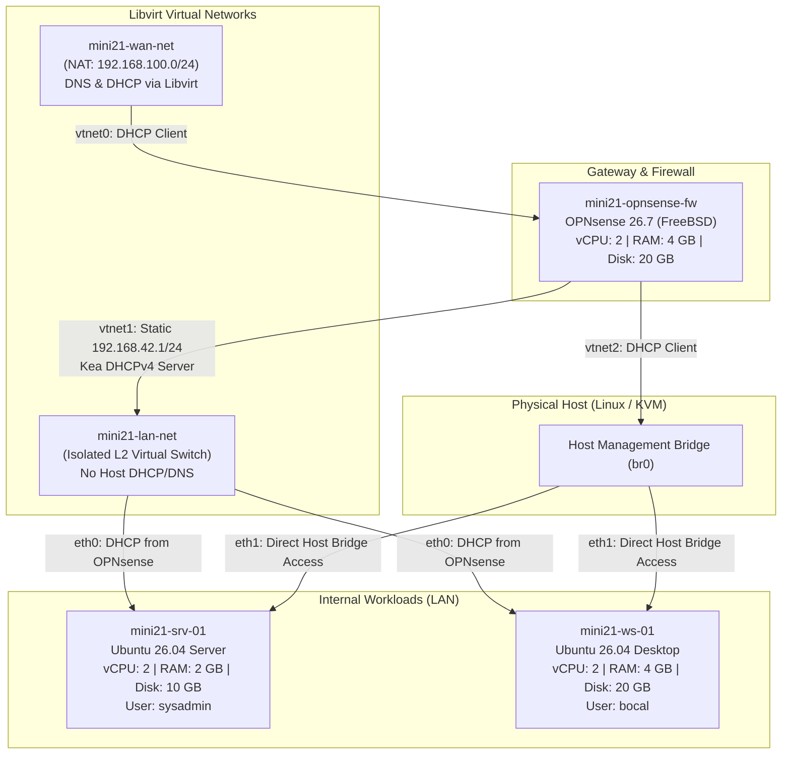

# Mini21 Network Infrastructure Simulation Lab

An automated Infrastructure-as-Code (IaC) laboratory built with **OpenTofu / Terraform** and **KVM/Libvirt**. This lab simulates a segmented enterprise/datacenter network featuring an **OPNsense Firewall & Gateway**, an **Ubuntu Server**, and an **Ubuntu Desktop Workstation**.

---

## Architecture & Network Topology



### Network Segmentation

| Network Name | Libvirt Mode | CIDR Subnet | Gateway | Roles & Services |
| :--- | :--- | :--- | :--- | :--- |
| **`mini21-wan-net`** | `nat` | `192.168.100.0/24` | `192.168.100.1` | Simulated ISP uplink; managed by libvirt dnsmasq. |
| **`mini21-lan-net`** | `none` (isolated) | `192.168.42.0/24` | `192.168.42.1` | Private internal LAN. OPNsense provides Kea DHCP, DNS (Unbound), and routing. |
| **`br0`** | Host Bridge | Host Subnet | Host LAN GW | Dedicated out-of-band management network directly reachable from the host. |

### Virtual Machine Specifications

| Virtual Machine | Hostname | OS / Base Image | vCPU | RAM | Disk | Network Interfaces |
| :--- | :--- | :--- | :--- | :--- | :--- | :--- |
| **`mini21-opnsense-fw`** | `OPNsense` | OPNsense 26.7 (FreeBSD) | 2 | 4096 MB | 20 GB | `vtnet0` (WAN), `vtnet1` (LAN), `vtnet2` (Mgmt) |
| **`mini21-srv-01`** | `srv-ubuntu-01` | Ubuntu 26.04 Server | 2 | 2048 MB | 10 GB | `eth0` (LAN DHCP), `eth1` (Mgmt Bridge) |
| **`mini21-ws-01`** | `z0t0c0` | Ubuntu 26.04 Desktop | 2 | 4096 MB | 20 GB | `eth0` (LAN DHCP), `eth1` (Mgmt Bridge) |

---

## Prerequisites

Ensure the following packages and configurations are present on the host system:

1. **OpenTofu or Terraform**:
   - OpenTofu `>= 1.6.0` (or Terraform `>= 1.6.0`)
2. **Virtualization Hypervisor**:
   - QEMU / KVM (`qemu-system-x86_64`)
   - Libvirt daemon running (`systemctl status libvirtd`)
   - Read/write access to `/dev/kvm`:
     ```bash
     sudo usermod -aG libvirt,kvm $USER
     ```
3. **Helper Utilities**:
   - `genisoimage` or `mkisofs` (used to package ephemeral config ISOs)
   - `python3` with `pexpect` module (`python3 -c "import pexpect"`)
   - `make`
4. **Host Network Bridge**:
   - A Linux bridge named `br0` (or your preferred management interface specified in `tofu.tfvars`).
5. **SSH Keypair**:
   - An Ed25519 or RSA public key located at `~/.ssh/id_ed25519.pub` (injected into Ubuntu instances via Cloud-Init).
6. **Base OS Images**:
   Located in the `images/` directory (symlinked to your cold storage):
   - `images/OPNsense-26.7.qcow2`: Base OPNsense image.
   - Ubuntu Cloud Image (e.g. `ubuntu-26.04-server-cloudimg-amd64.img`), or set `ubuntu_image_url` in `variables.tf`.

---

## Quickstart Guide

All common lifecycle tasks are wrapped in the [`Makefile`](file:///home/kawaii/code/mini42/terraform/Makefile).

### Step 1: Configure Variables
Create or customize [`tofu.tfvars`](file:///home/kawaii/code/mini42/terraform/tofu.tfvars):
```hcl
libvirt_uri         = "qemu:///system"
storage_pool_path   = "/storage/hot/kvm-vms/mini21"
opnsense_image_url  = "images/OPNsense-26.7-configured.qcow2"
ssh_public_key_path = "~/.ssh/id_ed25519.pub"
management_interface = "br0"
```

### Step 2: Initialize OpenTofu
Download and initialize provider plugins:
```bash
make init
# or: tofu init
```

### Step 3: Bake OPNsense Configuration Image (Offline)
OPNsense runs on FreeBSD with a UFS2 filesystem, which host Linux tools cannot directly modify without risking filesystem corruption. 

We provide an automated offline bake script that boots a headless QEMU micro-instance with KVM acceleration, mounts an ephemeral config ISO, writes [`config/config.xml`](file:///home/kawaii/code/mini42/terraform/config/config.xml) to `/conf/config.xml`, clears the cache, and powers off in **under 45 seconds**:

```bash
# Option A (Recommended): Build a fully independent standalone image (~2.1 GB)
make bake-image

# Option B: Build a fast, lightweight Copy-on-Write overlay (~13 MB)
make bake-image-overlay
```
*Output*: Produces `images/OPNsense-26.7-configured.qcow2`.

### Step 4: Plan Infrastructure Deployment
Inspect the plan before creating any resources:
```bash
make plan
# or: tofu plan -var-file=tofu.tfvars
```

### Step 5: Deploy the Lab
Deploy the virtual networks, storage volumes, and virtual machines:
```bash
make apply
# or: tofu apply -var-file=tofu.tfvars
```
On boot:
1. `mini21-opnsense-fw` starts with all interfaces, Kea DHCPv4, and OpenSSH pre-configured.
2. `mini21-srv-01` and `mini21-ws-01` boot, apply Cloud-Init user credentials, and obtain internal DHCP leases (`192.168.42.x`) from OPNsense.

---

## Interacting with the Lab

### 1. Serial Console Access
Each VM has an active serial PTY console connected to Libvirt. You can open direct terminal sessions using the Makefile shortcuts:

```bash
# Connect to OPNsense Firewall Console:
make console-fw

# Connect to Ubuntu Server Console:
make console-srv

# Connect to Ubuntu Desktop Console:
make console-ws
```
> [!TIP]
> **How to exit the console**: Press `Ctrl + ]` to detach from any `virsh console` session and return to your host shell.

### 2. Credentials & Authentication

| Virtual Machine | Service | Username | Password / Key | Notes |
| :--- | :--- | :--- | :--- | :--- |
| **`mini21-opnsense-fw`** | WebGUI (`https://192.168.42.1`) | `root` | Configured password in `config.xml` | Self-signed SSL certificate; accessible via LAN or Management IP. |
| **`mini21-opnsense-fw`** | Serial Console / SSH | `root` | Configured password in `config.xml` | Menu Option `8` drops to FreeBSD root shell (`csh`). |
| **`mini21-srv-01`** | SSH / Console | `sysadmin` | `~/.ssh/id_ed25519` key / sudo NOPASSWD | Sudo privileges enabled. |
| **`mini21-ws-01`** | SSH / Console / GUI | `bocal` | `~/.ssh/id_ed25519` key / sudo NOPASSWD | Desktop GUI available via VNC graphics port. |

### 3. Accessing the OPNsense WebGUI
- **From LAN Workloads**: Point any browser inside `mini21-ws-01` to `https://192.168.42.1`.
- **From the Host**: Look up the IP assigned to `vtnet2` (connected to `br0`) or check the OpenTofu output:
  ```bash
  virsh domifaddr mini21-opnsense-fw
  ```
  Open `https://<assigned-ip>` in your host browser.

---

## Maintenance & Lifecycles

### Updating OPNsense Configuration
Whenever you make changes to [`config/config.xml`](file:///home/kawaii/code/mini42/terraform/config/config.xml):
1. Re-run the offline bake script:
   ```bash
   make bake-image
   ```
2. Re-deploy the firewall:
   ```bash
   make apply
   ```

### Teardown & Destruction
To completely tear down the virtual machines, networks, and ephemeral storage pools:
```bash
make destroy
# or: tofu destroy -var-file=tofu.tfvars
```
> [!NOTE]
> **Source Image Persistence**: Running `make destroy` only deletes the active volumes inside the target storage pool (`/storage/hot/kvm-vms/mini21/*`). It **never** touches or deletes your source images in `images/` (`OPNsense-26.7-configured.qcow2` and `OPNsense-26.7.qcow2`).

### Full Lab Rebuild
To quickly destroy and rebuild from scratch:
```bash
make re
```

---

## Repository Directory Structure

```text
.
├── Makefile                     # Shortcut targets for bake, plan, apply, destroy, and consoles
├── main.tf                      # Core infrastructure definitions (storage, pool, network, VMs)
├── variables.tf                 # Global variable declarations
├── locals.tf                    # Local variables and prefixes
├── outputs.tf                   # Output maps (node topology and management addresses)
├── providers.tf                 # Libvirt provider configuration
├── versions.tf                  # Provider and OpenTofu version constraints
├── tofu.tfvars                  # Local variable values (gitignored)
├── config/
│   └── config.xml               # Target OPNsense XML configuration
├── scripts/
│   └── bake_opnsense_image.py   # Automated headless QEMU bake script for OPNsense
├── templates/
│   ├── server_init.cfg          # Cloud-Init user-data for Ubuntu Server (sysadmin)
│   └── desktop_init.cfg         # Cloud-Init user-data for Ubuntu Desktop (bocal)
├── modules/
│   ├── network/                 # Libvirt network module (WAN NAT + isolated LAN)
│   │   ├── main.tf
│   │   ├── variables.tf
│   │   └── outputs.tf
│   └── vm_node/                 # Reusable VM instance module (QCOW2 disk, Cloud-Init, Domain)
│       ├── main.tf
│       ├── variables.tf
│       └── outputs.tf
└── images -> /storage/cold/...  # Symlink to base disk images
```

---

## Troubleshooting

### 1. `Permission denied: /dev/kvm`
- Ensure your user is in the `kvm` and `libvirt` groups:
  ```bash
  sudo usermod -aG libvirt,kvm $USER
  newgrp kvm
  ```
- Test access:
  ```bash
  test -r /dev/kvm && test -w /dev/kvm && echo "KVM OK"
  ```

### 2. Stuck Console Session
- If you connect to `virsh console` and see a blank screen, press `Enter` to wake the prompt.
- To disconnect from any frozen or active console session, press `Ctrl + ]`.

### 3. OpenTofu State Lock
- If a command was interrupted, release the lock:
  ```bash
  tofu force-unlock <LOCK-ID>
  ```
